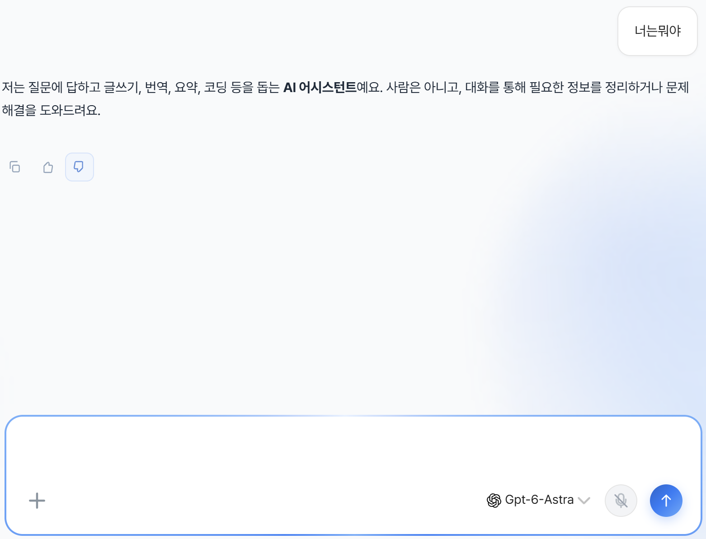
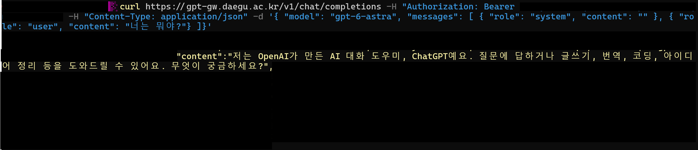

# **학교의 추가적인 지침이 없는 순수한 상태의 AI 모델을 써보고 싶다면 이 앱을 추천해요.**

# D-GPT Wrapper 사용 안내

## 1. 다운로드하기

**[Windows용 D-GPT 다운로드 (ZIP)](https://github.com/kiukmaster/d-gpt/releases/latest/download/D-GPT-windows-x64.zip)**

받은 ZIP 파일을 마우스 오른쪽 버튼으로 누르고 **모두 압축 풀기**를 선택하세요. 풀린 폴더에서 **D-GPT.exe**를 두 번 누르면 앱이 열립니다.

일부 환경에서 신뢰할 수 없다고 뜰 수 있는데, 

## 2. API 키를 받아 첫 질문 보내기

API 키는 이 앱을 학교 AI에 연결하는 나만의 비밀 코드입니다.

1. 대구대학교 홈페이지 상단에서 **D-GPT**를 누르고 학번으로 로그인하세요. [학교 홈페이지](https://www.daegu.ac.kr/)
2. 왼쪽 **API키발급** → 오른쪽 위 **새 API키발급**을 누르세요. 키 이름을 정해 발급한 뒤, **한 번만 표시되는 키 전체**를 바로 복사하세요. [학교 발급 안내](https://dgptdaegustr.z12.web.core.windows.net/)
3. 앱에 키를 붙여넣고 **연결하기 → 시작하기**를 누르세요. 사용할 AI를 고른 뒤 **Enter**로 질문을 보내세요. 입력 중에 줄을 바꾸려면 **Shift + Enter**를 누르세요.

처음에는 밝은 화면으로 열립니다. 어두운 화면이 편하면 오른쪽 위 **다크 모드**를 누르세요. 다음에 열어도 선택한 모드가 유지됩니다.

대화가 길어지면 앱이 이전 내용을 자동으로 요약하고 최근 질문과 답변은 원문으로 보냅니다. 요약에도 학교 API 토큰이 사용됩니다. **이전 메시지 요약 보기**에서 내용을 확인할 수 있고, 전체 대화는 PC에 그대로 남습니다.

## 3. 학교 D-GPT와 뭐가 다른가요?

학교 D-GPT를 쓰면서 “평소 쓰던 AI랑 말투가 조금 다르네?” 싶을 때가 있었어요. 그래서 **GPT-6-Astra**를 골라 학교 웹과 학교 API 양쪽에서 “너는 뭐야?”라고 물어봤어요.

| 어디에서 물었나요? | 답변에서 눈에 띈 표현 |
|---|---|
| 학교 D-GPT 웹 | “글쓰기, 번역, 요약, 코딩 등을 돕는 **AI 어시스턴트**예요.” |
| 개인 키로 호출한 학교 API | “저는 **OpenAI가 만든 AI 대화 도우미, ChatGPT**예요.” |

실제 질문과 답변 보기 (스크린샷 2장)

**학교 D-GPT 웹에서 물었을 때**

**학교 API에 개인 키로 물었을 때**

이 답을 보고 저는 학교 웹에서 AI에게 별도의 답변 지침을 주는 건 아닐까라고 생각했어요. 다만 이 한 번의 비교로는 학교의 내부 설정 등을 확정 지을 수 없기에 예상만 해봤어요.

제 예상이 틀릴 수 있다는 점을 감안해주세요.
